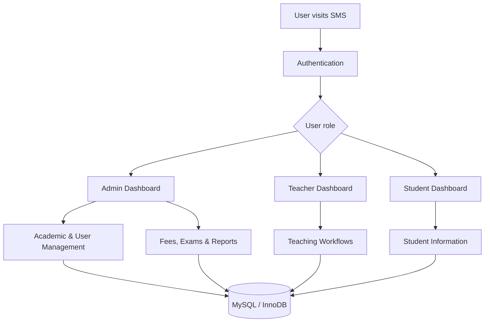

<div align="center">

# 🎓 Student Management System (SMS)

### A Laravel-based academic administration and student information platform

[](https://laravel.com/)
[](https://www.php.net/)
[](https://www.mysql.com/)
[](https://getbootstrap.com/)
[](https://github.com/AdityaGit8009/SMS)

**Manage students, teachers, academic records, attendance, fees, examinations, and reports from a unified application.**

[Repository](https://github.com/AdityaGit8009/SMS) · [Report an Issue](https://github.com/AdityaGit8009/SMS/issues) · [Developer](https://github.com/AdityaGit8009)

</div>

---

## 📌 Overview

**SMS (Student Management System)** is a web application built with **Laravel 13**, **Blade**, **Bootstrap 5**, **JavaScript**, **MySQL**, and **Eloquent ORM**. It is designed for academic institutions to organize administrative, teaching, and student-facing processes in one place.

The repository documents functionality for **three user roles**: Administrator, Teacher, and Student. The modules below reflect the repository's documented scope; test each workflow in your own environment before production use.

## ✨ Features

| Area | Documented capabilities |
| --- | --- |
| 🔐 Authentication | Login, logout, forgot/reset password, change password, role-based access |
| 🏫 Academic setup | Academic sessions, departments, courses, semesters, sections, subjects |
| 👩‍🏫 Staff & students | Teacher records, student records, student documents, profile management |
| 📅 Daily operations | Attendance, timetables, notices, leave management |
| 💳 Finance | Fee structures, payments, printable receipts |
| 📝 Assessments | Exams, schedules, marks, results, printable result sheets |
| 📚 Coursework | Assignments and student submissions |
| 🪪 Student services | Student ID cards with browser-generated QR codes |
| 📊 Analytics | Teacher/student/attendance/fee/exam/result reports and CSV exports |
| ⚙️ Administration | System settings and academic-session selection |

### Role-based experience

| Role | Primary responsibilities |
| --- | --- |
| **Admin** | Manage academic master data, teachers, students, fees, exams, and institutional reports |
| **Teacher** | Access teaching-related dashboard and relevant academic workflows |
| **Student** | Access student dashboard and student-facing academic information |

> **Note:** Actual permissions depend on the application's routes, middleware, and user policies. Do not assume every role can access every module.

## 🛠️ Technology Stack

| Layer | Technology |
| --- | --- |
| Backend | Laravel 13, PHP |
| Frontend | Blade templates, HTML, CSS, Bootstrap 5, JavaScript |
| Data layer | MySQL with InnoDB, Eloquent ORM |
| Tooling | Composer, Node.js/npm, Vite |
| Testing | Pest / Laravel testing tools (declared in Composer) |

`composer.json` declares **PHP ^8.3** and **Laravel ^13.17**. The repository's Windows setup notes recommend **PHP 8.4+**; PHP 8.4 is the safer choice when following those instructions.

## 🧭 Application Flow



## 📁 Project Structure

```text
SMS/
├── app/                 # Application logic, controllers and models
├── bootstrap/           # Laravel application bootstrap
├── config/              # Framework and application configuration
├── database/            # Migrations, seeders and factories
├── public/              # Public entry point and assets
├── resources/           # Blade templates and frontend source
├── routes/              # Application route definitions
├── storage/             # Logs and application-generated files
├── tests/               # Automated tests
├── .env.example         # Environment variable template
├── .env.sms-example     # SMS-specific configuration example
├── composer.json        # PHP dependencies
├── package.json         # Frontend dependencies
├── vite.config.js       # Asset bundling configuration
├── FIXES-AND-SETUP.md   # Additional setup and compatibility notes
└── artisan              # Laravel command-line entry point
```

## 🚀 Getting Started

### Prerequisites

- **PHP 8.4+ recommended** (Composer currently allows PHP 8.3+)
- **Composer**
- **Node.js and npm**
- **MySQL** (WAMP/XAMPP or another local installation)
- **Git**

### 1. Clone the repository

```bash
git clone https://github.com/AdityaGit8009/SMS.git
cd SMS
```

### 2. Install PHP and frontend dependencies

```bash
composer install
npm install
```

### 3. Configure the environment

On Windows Command Prompt:

```bat
copy .env.example .env
```

On macOS/Linux/Git Bash:

```bash
cp .env.example .env
```

Generate your local application encryption key:

```bash
php artisan key:generate
```

Update the database settings in `.env`:

```dotenv
APP_NAME="Student Management System"
APP_ENV=local
APP_DEBUG=true
APP_URL=http://127.0.0.1:8000

DB_CONNECTION=mysql
DB_HOST=127.0.0.1
DB_PORT=3306
DB_DATABASE=sms_db
DB_USERNAME=root
DB_PASSWORD=

MAIL_MAILER=log
```

Create the `sms_db` database in MySQL or phpMyAdmin before migrating. Change the username and password to match your local MySQL setup. **Never commit your `.env` file.**

### 4. Confirm the InnoDB storage engine

The repository includes a warning that its original WAMP setup defaulted to MyISAM. For relational tables and foreign keys, use **InnoDB**.

In MySQL:

```sql
SHOW VARIABLES LIKE 'default_storage_engine';
```

If necessary, set this in your MySQL `my.ini` (under the server section) and restart MySQL:

```ini
default-storage-engine=InnoDB
```

The existing project setup also advises reviewing the `mysql` connection in `config/database.php` for the following setting:

```php
'engine' => 'InnoDB',
```

### 5. Run database migrations and seeders

```bash
php artisan optimize:clear
php artisan migrate --seed
php artisan storage:link
```

> ⚠️ **Data safety:** The repository's original setup mentions `php artisan migrate:fresh --seed`, but `migrate:fresh` **deletes existing database tables and their data**. Use it only for a disposable development database after confirming that deletion is acceptable.

### 6. Start the application

In one terminal:

```bash
php artisan serve
```

In another terminal:

```bash
npm run dev
```

Open **http://127.0.0.1:8000** in your browser.

For a compiled frontend build, use `npm run build` instead of the Vite development server.

## 👤 Demo Accounts

The repository's existing README documents the following **local development accounts** after seeding:

| Role | Email | Password |
| --- | --- | --- |
| Admin | `admin@sms.com` | `Admin@123` |
| Teacher | `teacher@sms.com` | `Teacher@123` |
| Student | `student@sms.com` | `Student@123` |

**Important:** These are publicly documented test credentials. **Remove or change them before any public deployment**, and ensure production seeders do not recreate them.

## 🔑 Password Reset in Development

When `MAIL_MAILER=log` is configured, password-reset email output is written to:

```text
storage/logs/laravel.log
```

This is intended for local testing. Configure an actual mail transport before deployment.

## 🧪 Testing & Maintenance

```bash
# Run the application test suite
php artisan test

# Clear cached framework configuration
php artisan optimize:clear

# Inspect registered routes
php artisan route:list

# Build production frontend assets
npm run build
```

The presence of automated test tooling does not mean every feature has been tested. Validate key workflows and permissions before release.

## 🖨️ Printing & Exporting

- Fee receipts, exam results, and student ID cards can use the browser's **Print → Save as PDF** feature.
- The repository documents QR generation on student ID cards using a browser-loaded QR code library.
- CSV export functionality is documented for multiple reporting areas.

## 🔒 Security & Deployment Checklist

Before putting SMS online:

- Set `APP_ENV=production` and `APP_DEBUG=false`.
- Configure HTTPS, secure session cookies, and a trusted production email service.
- Replace all publicly documented demo accounts and passwords.
- Keep `.env`, logs, private student documents, and credentials out of public access.
- Review user roles, authorization policies, input validation, and file-upload restrictions.
- Back up the database and uploaded documents securely.
- Test fee, attendance, assignment, and results workflows with different user roles.
- Run database migrations on a backup or staging database first.

## 🗺️ Future Improvements

Ideas for future development (not claims about implemented features):

- Automated SMS/email notifications to students and teachers
- Parent/guardian portal
- Better analytical charts and configurable reporting
- Automated CI tests and deployment pipelines
- Audit logging for sensitive academic and financial updates
- Exportable institutional dashboards

## 📚 Project Documentation

- [Original setup and fixes](FIXES-AND-SETUP.md)
- [Laravel documentation](https://laravel.com/docs)
- [Repository issues](https://github.com/AdityaGit8009/SMS/issues)

## 👨‍💻 Developer

**Aditya Pratap Vishwakarma**

- **GitHub:** [@AdityaGit8009](https://github.com/AdityaGit8009)
- **LinkedIn:** [vish-aditya](https://www.linkedin.com/in/vish-aditya/)
- **Email:** [adityapratap7391@gmail.com](mailto:adityapratap7391@gmail.com)

## 📄 License

Check the repository for a project-specific `LICENSE` file before using or redistributing this application. The Laravel framework's license does not automatically define the license for all project-specific source files.

---

<div align="center">

**Built with Laravel • Designed for practical academic management**

⭐ If this project is useful, consider starring the [repository](https://github.com/AdityaGit8009/SMS).

</div>
