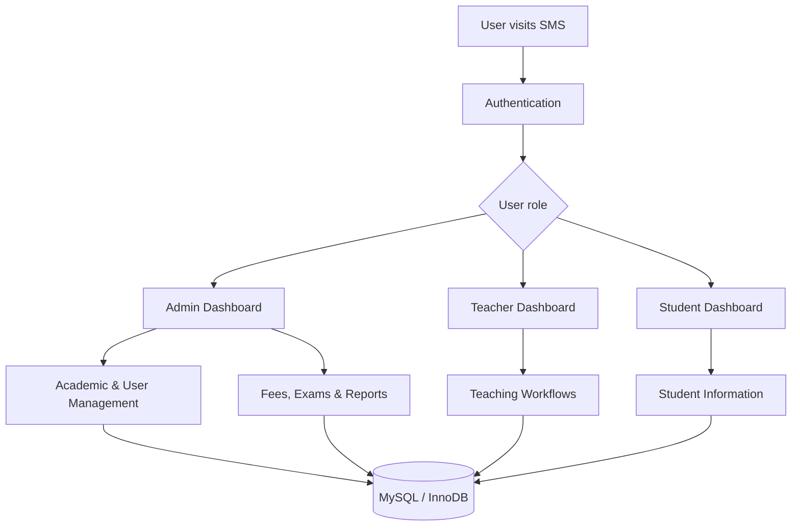

<div align="center">

# 🎓 Student Management System (SMS)

### A Laravel-based academic administration and student information platform

[](https://laravel.com/)
[](https://www.php.net/)
[](https://www.mysql.com/)
[](https://getbootstrap.com/)
[](https://github.com/AdityaGit8009/SMS)

**Manage students, teachers, academic records, attendance, fees, examinations, and reports from a unified application.**

[Repository](https://github.com/AdityaGit8009/SMS) · [Report an Issue](https://github.com/AdityaGit8009/SMS/issues) · [Developer](https://github.com/AdityaGit8009)

</div>

---

## 📌 Overview

**SMS (Student Management System)** is a web application built with **Laravel 13**, **Blade**, **Bootstrap 5**, **JavaScript**, **MySQL**, and **Eloquent ORM**. It is designed for academic institutions to organize administrative, teaching, and student-facing processes in one place.

The application serves administrators, teachers and students through separate dashboards with shared sign-in and profile management.

## ✨ Features

| Area | Documented capabilities |
| --- | --- |
| 🔐 Authentication | Login, logout, forgot/reset password, change password, role-based access |
| 🏫 Academic setup | Academic sessions, departments, courses, semesters, sections, subjects |
| 👩‍🏫 Staff & students | Teacher records, student records, student documents, profile management |
| 📅 Daily operations | Attendance, timetables, notices, leave management |
| 💳 Finance | Fee structures, payments, printable receipts |
| 📝 Assessments | Exams, schedules, marks, results, printable result sheets |
| 📚 Coursework | Assignments and student submissions |
| 🪪 Student services | Student ID cards with browser-generated QR codes |
| 📊 Analytics | Teacher/student/attendance/fee/exam/result reports and CSV exports |
| ⚙️ Administration | System settings and academic-session selection |

### Role-based experience

| Role | Dashboard | Workflows available through the panel |
| --- | --- | --- |
| **Admin** | `/admin/dashboard` | Academic setup, teacher and student records, attendance, fees and receipts, examinations, marks, timetables, notices, leave review, reports and settings |
| **Teacher** | `/teacher/dashboard` | Attendance for assigned subjects, assignments and grading, personal timetable, course notices and leave requests |
| **Student** | `/student/dashboard` | Personal attendance, fees, published results, assignments, timetable, notices, leave requests and ID card |

All three roles can edit their profile, change their password and sign out. The home route selects a dashboard after sign-in. Route groups and role checks are defined in [routes/web.php](routes/web.php) and [RoleMiddleware.php](app/Http/Middleware/RoleMiddleware.php).

## 🛠️ Technology Stack

| Layer | Technology |
| --- | --- |
| Backend | Laravel 13, PHP |
| Frontend | Blade templates, HTML, CSS, Bootstrap 5, JavaScript |
| Data layer | MySQL with InnoDB, Eloquent ORM |
| Tooling | Composer, Node.js/npm, Vite |
| Testing | Pest feature tests for role navigation, attendance, exams, marks, fees, reports and student documents |

The committed lockfile requires **PHP 8.4.1 or later**. Run `composer check-platform-reqs` after installation to verify the CLI version and extensions.

## 🧭 Application Flow



## 📁 Project Structure

| Location | What it contains |
| --- | --- |
| [routes/web.php](routes/web.php) | Sign-in, password and profile endpoints followed by the admin, teacher and student route groups |
| [app/Http/Controllers](app/Http/Controllers) | Role-specific dashboards and operations, plus shared attendance, assignment, leave and timetable workflows |
| [app/Models](app/Models) | Academic and financial records and their Eloquent relationships |
| [database/migrations](database/migrations) and [database/seeders](database/seeders) | Schema, foreign keys and a local sample cohort with one account per role |
| [resources/views](resources/views) | Blade page templates, print views and shared panel layouts |
| [public/css](public/css) and [public/js](public/js) | The styles and interactions loaded by the dashboard and authentication pages |
| [config/filesystems.php](config/filesystems.php) and [routes/console.php](routes/console.php) | Public and private file locations and the legacy student-document migration command |
| [tests/Feature](tests/Feature) and [phpunit.xml](phpunit.xml) | Request and workflow tests, with an in-memory SQLite database by default |

## 🚀 Getting Started

### Install the PHP dependencies

Use PHP 8.4.1 or later with Composer and the PDO driver for your chosen database. The committed lockfile installs Laravel 13, Pest 5 and Symfony packages that require PHP 8.4.1. On WAMP, check the version of the PHP executable on your terminal's PATH.

```bash
git clone https://github.com/AdityaGit8009/SMS.git
cd SMS
composer install
composer check-platform-reqs
```

Copy `.env.example` to `.env` using `Copy-Item .env.example .env` in PowerShell or `cp .env.example .env` on macOS and Linux. Generate the application's encryption key.

```bash
php artisan key:generate
```

To sign into the demo immediately after setup, choose a local password and set `SMS_DEMO_PASSWORD` in `.env` before the first seed.

### Choose a database

**SQLite** is the default in `.env.example`. Enable PDO SQLite and create the database file from the project root.

```bash
php -r "file_exists('database/database.sqlite') || touch('database/database.sqlite');"
```

**MySQL** uses InnoDB foreign keys. Create an empty database, set the following values in `.env` and supply your own local credentials.

```dotenv
DB_CONNECTION=mysql
DB_HOST=127.0.0.1
DB_PORT=3306
DB_DATABASE=sms_db
DB_USERNAME=your_local_user
DB_PASSWORD=
```

WAMP users can check the server default with `SHOW VARIABLES LIKE 'default_storage_engine';`. The application also requests InnoDB when creating its MySQL tables.

### Migrate and start SMS

```bash
php artisan migrate --seed
php artisan storage:link
php artisan serve
```

Open the local URL printed by Artisan. The dashboard and sign-in layouts load their styles and JavaScript from `public/css/sms.css` and `public/js/sms.js`. Bootstrap, icons and fonts load from their configured CDNs. The storage link serves public assets such as profile photos.

For work on the Vite entry points in `resources/css/app.css` and `resources/js/app.js`, install the locked Node dependencies with `npm ci`. Use `npm run dev` while editing or `npm run build` for a production bundle.

## 👤 Demo Accounts

The demo seeder runs in `local` and `testing` environments. Before the first seed, set `SMS_DEMO_PASSWORD` to a password of your choice in the local `.env`. Sign in as `admin@example.test`, `teacher@example.test`, or `student@example.test`. Without that setting, the seeder generates a separate random password for each account. You can use the local password-reset flow to choose one. Reseeding preserves existing passwords.

## 🔑 Password Reset in Development

When `MAIL_MAILER=log` is configured, password-reset email output is written to:

```text
storage/logs/laravel.log
```

This is intended for local testing. Configure an actual mail transport before deployment.

## 🧪 Testing & Maintenance

```bash
# Run the suite against in-memory SQLite
php artisan test --compact

# Clear cached framework configuration
php artisan optimize:clear

# Inspect registered routes
php artisan route:list

# Build production frontend assets
npm run build
```

The presence of automated test tooling does not mean every feature has been tested. Validate key workflows and permissions before release.

## 🖨️ Printing & Exporting

- Fee receipts, exam results, and student ID cards can use the browser's **Print → Save as PDF** feature.
- The repository documents QR generation on student ID cards using a browser-loaded QR code library.
- CSV export functionality is documented for multiple reporting areas.

## 🔒 Security & Deployment Checklist

Before putting SMS online:

- Set `APP_ENV=production` and `APP_DEBUG=false`.
- Configure HTTPS, secure session cookies, and a trusted production email service.
- Review any accounts created by earlier demo seeders and rotate their passwords before deploying an existing installation.
- Keep `.env`, logs, private student documents, and credentials out of public access.
- Review user roles, authorization policies, input validation, and file-upload restrictions.
- Back up the database and uploaded documents securely.
- Test fee, attendance, assignment, and results workflows with different user roles.
- Run database migrations on a backup or staging database first.

## 🗺️ Future Improvements

Ideas for future development (not claims about implemented features):

- Automated SMS/email notifications to students and teachers
- Parent/guardian portal
- Better analytical charts and configurable reporting
- Automated CI tests and deployment pipelines
- Audit logging for sensitive academic and financial updates
- Exportable institutional dashboards

## 📚 Project Documentation

- [Original setup and fixes](FIXES-AND-SETUP.md)
- [Laravel documentation](https://laravel.com/docs)
- [Repository issues](https://github.com/AdityaGit8009/SMS/issues)

## 👨‍💻 Developer

**Aditya Pratap Vishwakarma**

- **GitHub:** [@AdityaGit8009](https://github.com/AdityaGit8009)
- **LinkedIn:** [vish-aditya](https://www.linkedin.com/in/vish-aditya/)
- **Email:** [adityapratap7391@gmail.com](mailto:adityapratap7391@gmail.com)

## 📄 License

Check the repository for a project-specific `LICENSE` file before using or redistributing this application. The Laravel framework's license does not automatically define the license for all project-specific source files.

---

<div align="center">

**Built with Laravel • Designed for practical academic management**

⭐ If this project is useful, consider starring the [repository](https://github.com/AdityaGit8009/SMS).

</div>
